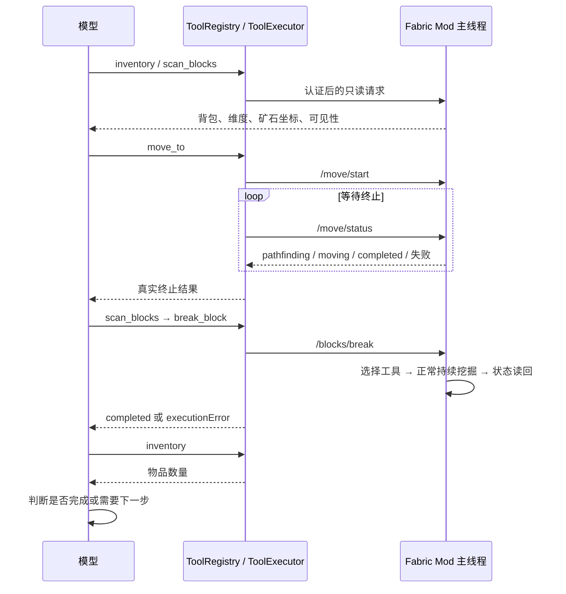

# 原子动作执行闭环（第一阶段）

本阶段将 Numen 的“LLM 决策、执行器控制身体”设计接到当前 Node + Fabric 项目：模型选择工具，Node 校验和等待，Mod 在主线程执行。保留原 `minecraft_mining` 兼容接口，新增独立原子接口供模型逐步决策。



## 实现边界

- 模型负责选择目标和下一次工具调用；不是训练好的固定“挖铁”决策树。
- Mod 负责有限扫描、局部地面寻路、真实装备交换、正常挖掘进度和放置交互；不会自动挖路或搭桥。
- Node 工具等待终止，结果经已有 ReAct 循环进入下一次模型请求。预算仍由 `maxToolRounds` 和 `ToolExecutor` 超时控制。
- 统一事件源读取 `/state.move` 和 `/state.action`。每个操作都有 UUID，任务状态只匹配相同 UUID；完成事件不会取消自己，取消请求不能停止另一个操作。
- 原子动作持久化到 `TaskStateStore`，默认 `resumePolicy: never`。这是防止动作被盲目重放的执行层；**尚未增加跨重启的采集目标执行器**。
- `verification: client_snapshot` 是客户端读回，不是服务端回执。破坏一个方块和背包拾取到产物是两个事实，模型需要读背包验证后者。

自动合成工具已在后续阶段接入，见[自动合成说明](crafting.md)。从无镐子开始升级装备的完整游戏内验收、远距离探索、长目标自主续跑和经验自动晋升仍未完成，因此“没有镐子 → 砍树 → 合成 → 石镐 → 铁矿”全链还不能宣称已通过验收。

## 接口

Mod 继续只监听 `127.0.0.1`，请求必须携带实例 Bearer token；模型只获得后端工具 schema。

| Node 工具 | Mod 接口 | 结果 |
| --- | --- | --- |
| `minecraft_scan_blocks` | `POST /blocks/scan` | 已加载方块、维度、可见性、交互距离 |
| `minecraft_move_to` | `POST /move/start`，`GET /move/status` | 到达或失败后返回 |
| `minecraft_break_block` | `POST /blocks/break`，`GET /blocks/status` | 挖掘结果 |
| `minecraft_place_block` | `POST /blocks/place`，`GET /blocks/status` | 放置结果 |
| 取消 | `POST /move/stop` 或 `/blocks/stop`，body: `{taskId}` | 只停止匹配 UUID 的动作 |

所有 Node 参数和 Mod 参数分别校验。Mod 再次检查世界、维度、坐标、交互距离、视线、工具、预期目标和动作互斥。背包/界面变化、危险状态、超时、离开世界均停止动作。

调试示例（明确选择目标窗口，破坏和放置会修改世界）：

```http
POST /api/skills/minecraft_scan_blocks
Content-Type: application/json

{"windowId":"<实例 ID>","blocks":["minecraft:iron_ore","minecraft:deepslate_iron_ore"],"radius":8,"maxResults":16}
```

读取返回的 `dimension` 和坐标后，调用移动工具，随后重新扫描确认目标：

```json
{"windowId":"<实例 ID>","x":10,"y":64,"z":10,"dimension":"minecraft:overworld","distance":2}
```

破坏工具请求体：

```json
{"windowId":"<实例 ID>","x":10,"y":64,"z":10,"dimension":"minecraft:overworld","expectedBlockId":"minecraft:iron_ore"}
```

放置工具请求体，目标是最终方块所在格，`up` 表示点击其下方支撑格的顶面：

```json
{"windowId":"<实例 ID>","x":10,"y":64,"z":10,"dimension":"minecraft:overworld","itemId":"minecraft:cobblestone","face":"up"}
```

修改世界的工具返回真实终止结果，可通过 `GET /api/tasks`、`GET /api/events` 读取进展。请求断开或执行中断会按 UUID 请求停止；操作已完成的世界修改不会回滚。

## 验证和交付

`tests/atomic-actions.test.mjs` 使用真实本地 HTTP mock Mod 和生产 `registerAtomicTools`，验证非法参数拒绝、无路失败、取消下传、完成状态持久化、操作 ID 关联、并发写盘和完整 ReAct 示例。模型回复也为测试桩。

示例经过 7 次模拟模型响应、6 次工具调用：背包 → 扫描 → 移动 → 重新扫描 → 挖掘 → 背包 → 模型最终回复。它验证编排和传输，不等于真实 Minecraft 中成功采矿。

验证命令：`npm test`、`python minecraft-ai-mod/compile-manual.py`。编译后的 Mod 使用 `minecraft-ai-mod/package-manual.ps1` 打包为 `minecraft-ai-mod/build/libs/minecraft-ai-0.2.0.jar`。

替换客户端 Mod 后需完全退出并重启 Minecraft，同时重启 Node 控制台。尚未在真实世界执行破坏或放置；实际寻路、服务器采集限制和放置预测仍需要选定实例后做游戏内验收。
